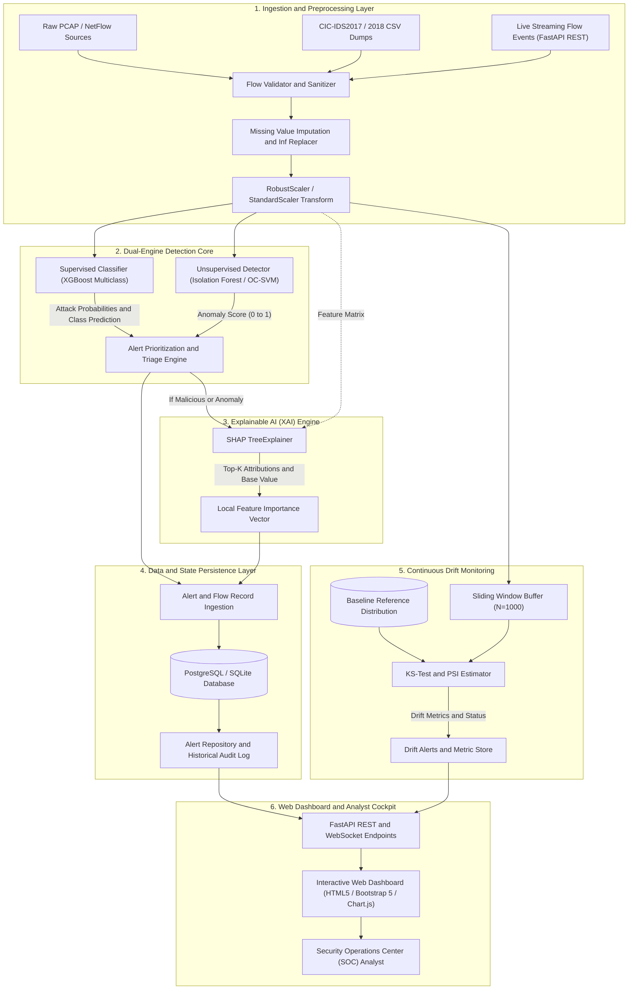
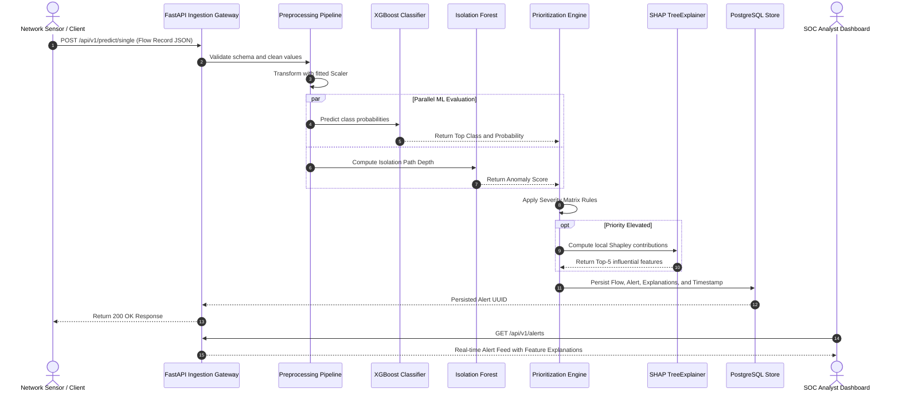
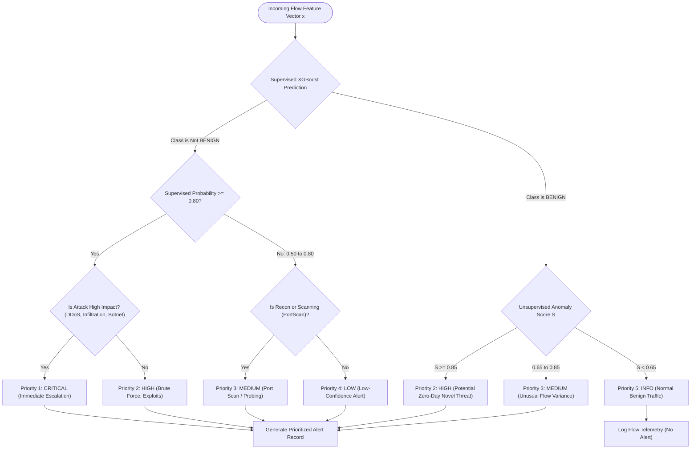
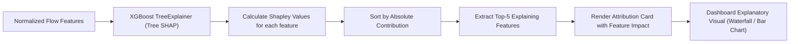
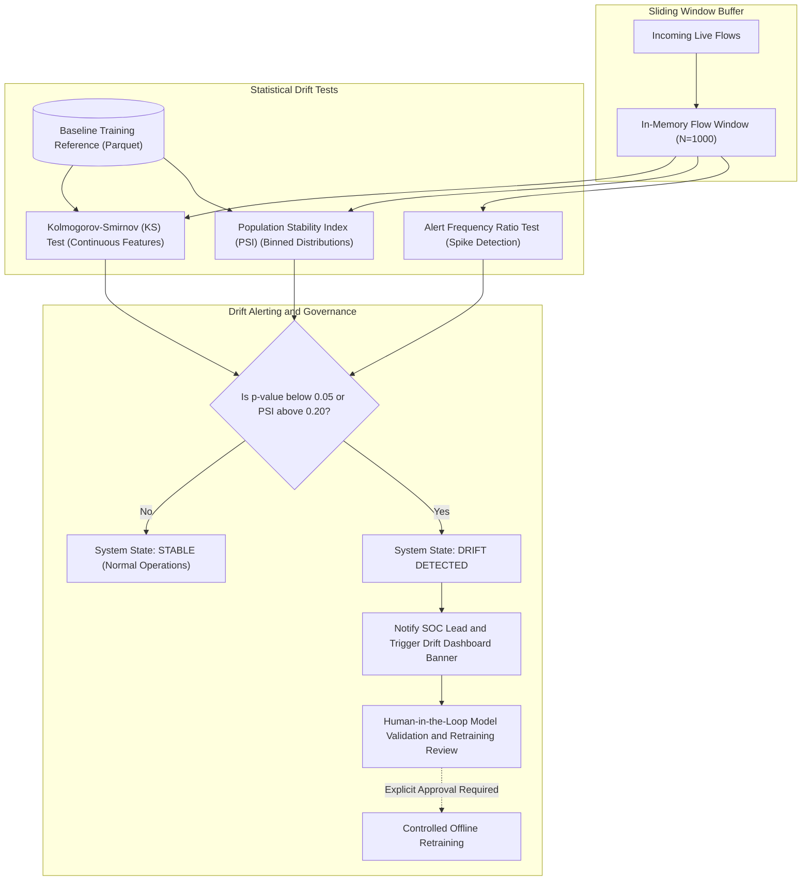
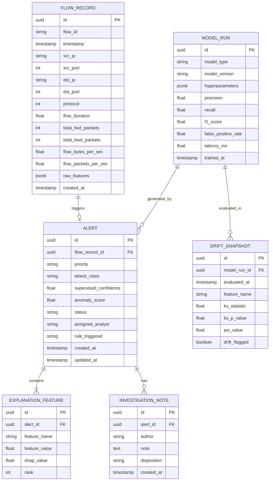

# CyberSentinel AI: System Architecture & Technical Blueprint

---

## 1. High-Level System Architecture

CyberSentinel AI adopts an asynchronous, modular microservice-style architecture designed to ingest network flow records, execute parallel machine learning inferences (supervised classification + unsupervised anomaly detection), compute SHAP-based feature attributions, triage alert priorities, and surface actionable telemetry to security analysts.

---

## 2. End-to-End Data Flow Pipeline

---

## 3. Dual-Engine Decision Fusion Logic

The system does not rely on a single classifier. Instead, it fuses supervised predictions (for recognized attacks) and unsupervised scores (for deviations from the benign baseline) through a rule-based priority state machine:

---

## 4. SHAP Feature Attribution Pipeline

For every prioritized alert, CyberSentinel AI executes a SHAP (SHapley Additive exPlanations) attribution step to convert the model's inner decision into an understandable visual breakdown for the security analyst:

### Interpretation Example:
- **Alert**: `DDoS_Hulk` (Priority: CRITICAL)
- **Top 5 Contributing Features**:
  1. `Flow Packets/s = 193,406` ($\phi_1 = +3.42$ push towards attack)
  2. `Flow Bytes/s = 23,076,923` ($\phi_2 = +2.18$)
  3. `Fwd PSH Flags = 350` ($\phi_3 = +1.89$)
  4. `Average Packet Size = 119.6` ($\phi_4 = +0.74$)
  5. `Init_Win_bytes_forward = 65535` ($\phi_5 = +0.31$)

---

## 5. Traffic Drift Monitoring Architecture

Network distributions shift over time. To prevent undetected model decay, CyberSentinel AI monitors both continuous feature distributions and categorical alert rates:

---

## 6. Database Entity-Relationship (ER) Diagram

---

## 7. Component Interaction & Tech Stack Mapping

| Layer / Subsystem | Primary Technologies | Key Responsibilities |
|---|---|---|
| **Data Ingestion** | Python, Pydantic, NumPy, pandas | Flow schema validation, missing value imputation, type casting, batch/stream parsing |
| **Supervised Classifier** | XGBoost, scikit-learn | Multi-class intrusion classification, confidence estimation, model version tracking |
| **Anomaly Detector** | scikit-learn (IsolationForest / OC-SVM) | Baseline profiling, outlier scoring, novel traffic flag generation |
| **Alert Triage** | Python, PyYAML | Severity rule matrix evaluation, hybrid alert prioritization (P1-P5) |
| **Explainable AI (XAI)** | SHAP (`TreeExplainer`) | Fast local feature attribution, waterfall data transformation |
| **Drift Monitoring** | SciPy, NumPy, custom PSI routines | Two-sample KS test, binned PSI distribution shift, anomaly rate tracking |
| **API Backend** | FastAPI, Uvicorn, SQLAlchemy | High-concurrency REST endpoints, async database sessions, OpenAPI docs |
| **Database** | PostgreSQL / SQLite | ACID persistence for flows, alerts, SHAP attributions, investigation notes |
| **Frontend UI** | HTML5, Modern CSS, Bootstrap 5, Chart.js | Real-time security telemetry, interactive alert triage, SHAP visualizations |
