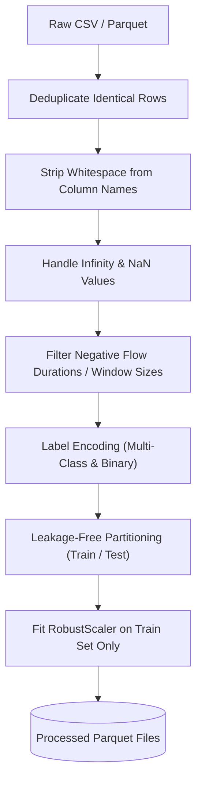

# CyberSentinel AI: Network Flow Dataset Guide & Preprocessing Protocols

This guide instructs the team on acquiring, preprocessing, splitting, and benchmarking the **CIC-IDS2017** and **CSE-CIC-IDS2018** network intrusion detection datasets while avoiding critical machine learning pitfalls such as data leakage and class imbalance skew.

---

## 1. Dataset Overview

Modern NIDS algorithms rarely operate on raw payload packets due to TLS 1.3 encryption, privacy mandates, and line-rate gigabit throughput constraints. Instead, they operate on **bidirectionally aggregated network-flow records** (generated by tools like `CICFlowMeter` or `Argus`).

A network flow is uniquely keyed by a **5-tuple**:
$$(\text{Source IP}, \text{Source Port}, \text{Destination IP}, \text{Destination Port}, \text{Protocol})$$
bounded by a flow inactivity timeout (typically 120 seconds).

### CIC-IDS2017 Benchmark Structure
Recorded inside an emulated enterprise testbed at UNB over 5 consecutive days:
- **Monday**: 100% Benign operational baseline traffic (~530k flows).
- **Tuesday**: Brute force attacks (FTP-Patator, SSH-Patator).
- **Wednesday**: DoS (Slowloris, Slowhttptest, Hulk, GoldenEye) and Heartbleed.
- **Thursday**: Web Attacks (Brute Force, XSS, SQL Injection) and Infiltration.
- **Friday**: Botnet ARES, PortScan sweeps, and DDoS LOIC floods.

---

## 2. Feature Taxonomy (Key 78+ Features)

Flow features extracted by `CICFlowMeter` are categorized into 5 primary groups:

### 1. Volume & Byte Metrics
- `Total Fwd Packets`, `Total Backward Packets`: Count of packets in forward/backward directions.
- `Total Length of Fwd Packets`, `Total Length of Bwd Packets`: Total byte volume.
- `Fwd Packet Length Max/Min/Mean/Std`: Packet size statistics.
- `Bwd Packet Length Max/Min/Mean/Std`: Reverse direction packet size statistics.

### 2. Temporal & Inter-Arrival Time (IAT) Metrics
- `Flow Duration`: Total duration of the connection in microseconds.
- `Flow IAT Mean/Std/Max/Min`: Time delta between consecutive packets.
- `Fwd IAT Total/Mean/Std/Max/Min`: Inter-arrival time for forward packets.
- `Bwd IAT Total/Mean/Std/Max/Min`: Inter-arrival time for backward packets.

### 3. Rate & Throughput Metrics
- `Flow Bytes/s`: Total bytes divided by flow duration.
- `Flow Packets/s`: Total packets divided by flow duration.
- `Fwd Packets/s`, `Bwd Packets/s`: Directional throughput.

### 4. TCP Protocol & State Flags
- Flag counters: `FIN Flag Count`, `SYN Flag Count`, `RST Flag Count`, `PSH Flag Count`, `ACK Flag Count`, `URG Flag Count`, `CWR Flag Count`, `ECE Flag Count`.
- `Init_Win_bytes_forward`, `Init_Win_bytes_backward`: Initial TCP window advertisement sizes (crucial for fingerprinting OS and scanning tools).
- `min_seg_size_forward`: Minimum segment size observed.

### 5. Activity Cycles
- `Active Mean/Std/Max/Min`: Time flow was active before becoming idle.
- `Idle Mean/Std/Max/Min`: Time flow was idle before becoming active.

---

## 3. Data Cleansing & Preparation Pipeline



### Critical Data Cleaning Steps:
1. **Column Header Whitespace**: Original CIC-IDS2017 CSVs have trailing/leading spaces (e.g., `' Destination Port'`, `' Flow Duration'`). All column headers must be stripped:
   ```python
   df.columns = df.columns.str.strip()
   ```
2. **Infinite Values**: When `Flow Duration == 0`, computing `Flow Bytes/s` or `Flow Packets/s` creates `+Inf`. Replace `np.inf` with the 99.9th percentile value or column maximum, and replace `np.nan` with `0.0`.
3. **Invalid Artifacts**: Remove flows with negative `Flow Duration` or invalid negative TCP header lengths.

---

## 4. Preventing Train-Test Data Leakage

> [!WARNING]
> Standard random cross-validation (`train_test_split(shuffle=True)`) causes **severe optimistic bias (data leakage)** on network traffic. When an attacker sends a flood of packets, dozens of flows with identical IP pairs, ports, and behaviors are produced within minutes. A random split puts twin flows into both train and test, yielding artificially high accuracy (>99.9%) that collapses in real deployment.

### Solution: Structured Partitioning Strategy
1. **Grouped / IP-Pair Splitting**: Split data such that individual source IP addresses or distinct attack campaigns only appear in *either* the training set *or* the test set.
2. **Temporal Splitting**: Train on earlier timestamps and test on chronologically later timestamps.
3. **Scaler Fitting**: Always fit scalers (`StandardScaler`, `RobustScaler`) **only on the training split**, then apply the fitted transformation to test/validation splits.

---

## 5. Class Imbalance Mitigation

Network data is inherently imbalanced: `BENIGN` traffic typically accounts for 80% to 95% of all samples, while rare attacks like `Heartbleed` or `Infiltration` may comprise less than 0.05%.

Recommended techniques:
1. **Balanced Class Weighting**: Pass `scale_pos_weight` or compute class weights dynamically in XGBoost:
   $$w_k = \frac{N}{K \cdot N_k}$$
2. **Evaluation Metrics**: **Never use Accuracy alone**. Evaluate using **Class-wise Recall**, **Macro F1-score**, and **False Positive Rate (FPR)** on benign traffic.
