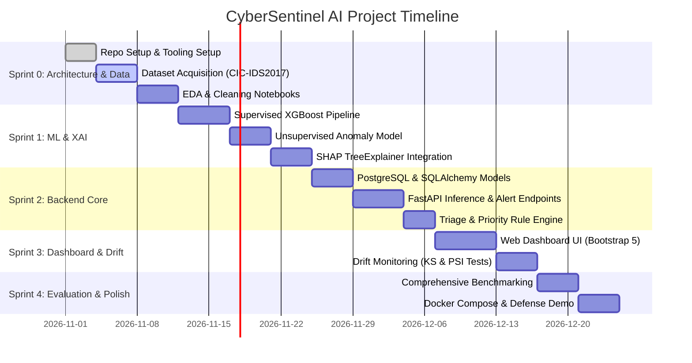

# CyberSentinel AI: Team Development Roadmap & Execution Plan

This document outlines the collaborative engineering roadmap, team role allocations, sprint breakdown, and technical milestones for building **CyberSentinel AI** from scratch to production readiness.

---

## 1. Team Composition & Role Distribution

| Role | Key Focus Areas | Primary Modules & Files |
|---|---|---|
| **ML Engineer / Data Scientist** | Dataset preprocessing, leakage-free splitting, XGBoost training, Isolation Forest anomaly tuning, SHAP explainability calibration | `src/cybersentinel/models/`, `src/cybersentinel/explainability/`, `src/cybersentinel/evaluation/`, `notebooks/` |
| **Backend & Systems Engineer** | FastAPI API endpoints, asynchronous database schemas, SQLAlchemy models, alert triage engine, rule parser | `src/cybersentinel/api/`, `src/cybersentinel/database/`, `src/cybersentinel/prioritization/`, `src/cybersentinel/config.py` |
| **Frontend & UI Developer** | Bootstrap 5 dashboard, Chart.js graphs, SHAP waterfall rendering, real-time alert triage feed, export reports | `src/cybersentinel/dashboard/`, `src/cybersentinel/dashboard/templates/`, `static/` |
| **DevOps & QA / SecOps** | Docker Compose environment, CI/CD pipeline, synthetic flow generator, load testing, drift testing | `docker/`, `.github/workflows/`, `tests/`, `config/` |

---

## 2. Sprint-by-Sprint Roadmap

---

## 3. Sprint Deliverables & Task Breakdown

### Sprint 0: Scaffolding, Data Acquisition & EDA (Week 1)
- [x] Repository initialized with architecture, problem statement, and technical specifications.
- [ ] Download CIC-IDS2017 CSV files into `data/raw/`.
- [ ] Run `notebooks/01_exploratory_data_analysis.ipynb`:
  - Inspect class imbalances, zero-duration flows, and inf values.
  - Generate correlation heatmaps and identify high-importance feature candidates.
- [ ] Implement `src/cybersentinel/ingestion/preprocessor.py` for automated data cleaning.

### Sprint 1: Dual-Engine ML & Explainability (Week 2 - 3)
- [ ] **Supervised Classifier**:
  - Implement stratified, leakage-free temporal/grouped train-test split.
  - Train XGBoost multi-class classifier on benign + attack classes.
  - Optimize hyperparameters (`max_depth`, `learning_rate`, `subsample`).
- [ ] **Unsupervised Anomaly Detector**:
  - Fit `IsolationForest` on benign-only baseline traffic.
  - Calibrate contamination rate $\tau$ to limit false positives on validation flows.
- [ ] **SHAP Explainability**:
  - Integrate `shap.TreeExplainer` on the fitted XGBoost model.
  - Implement top-K feature attribution extractor returning JSON payloads.
  - Serialize models and scalers into `models/`.

### Sprint 2: Backend REST Architecture & Persistence (Week 4)
- [ ] Set up SQLAlchemy ORM models in `src/cybersentinel/database/models.py`.
- [ ] Implement database CRUD operations for alerts and audit notes.
- [ ] Build FastAPI endpoints:
  - `POST /api/v1/predict/single` (real-time stream prediction).
  - `POST /api/v1/predict/batch` (high-throughput batch analysis).
  - `GET /api/v1/alerts` (filtered pagination).
  - `PATCH /api/v1/alerts/{id}/status` (analyst triage actions).
- [ ] Implement `src/cybersentinel/prioritization/engine.py` connecting the rule matrix.

### Sprint 3: Web Dashboard & Traffic Drift Engine (Week 5)
- [ ] Build the SOC dashboard frontend using HTML5, Bootstrap 5, and Chart.js.
- [ ] Render interactive SHAP contribution cards for investigated alerts.
- [ ] Implement `src/cybersentinel/drift/detector.py`:
  - Calculate Two-Sample Kolmogorov-Smirnov (KS) statistic on sliding buffers.
  - Compute Population Stability Index (PSI) per feature.
- [ ] Surface drift status and alert frequency charts on the dashboard.

### Sprint 4: Benchmarking, Containerization & Demo (Week 6)
- [ ] Run benchmark evaluation in `src/cybersentinel/evaluation/evaluator.py`:
  - Compute Precision, Recall, Macro-F1, FPR, and Latency per flow.
  - Generate confusion matrix figures.
- [ ] Verify multi-container orchestration via `docker-compose up --build`.
- [ ] Conduct end-to-end rehearsal with live simulated streaming traffic.

---

## 4. Definition of Done (DoD) Checklist

For each module to be marked complete:
1. **Type Annotations**: All Python functions must include static type hints (`mypy` compliant).
2. **Unit Tests**: Minimum 80% code coverage on core logic in `tests/unit/`.
3. **No Hardcoded Secrets**: Credentials loaded via `.env` and `pydantic-settings`.
4. **Leakage Safeguards**: Preprocessing scalers fitted strictly on training partitions.
5. **Human-in-the-Loop Integrity**: Drift detection emits alert indicators without non-deterministic automatic retraining.
